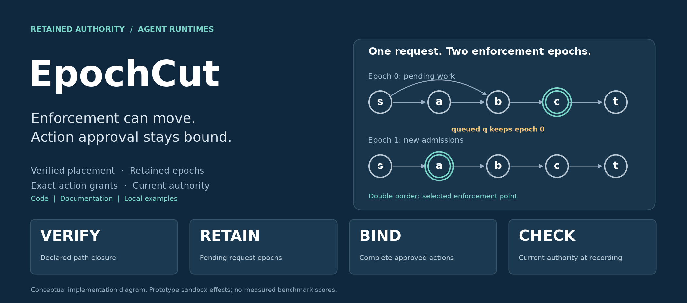
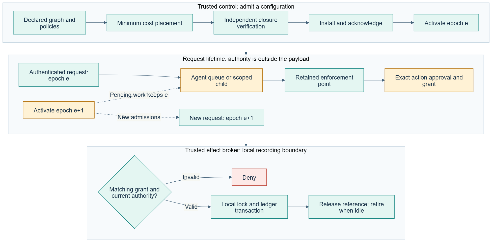

<p align="center">
  
</p>

<p align="center">
  <a href="https://github.com/Devchandrasen/EpochCut/actions/workflows/ci.yml"></a>
  
  
</p>

# EpochCut

**Verified enforcement epochs for agent runtimes.**

An agent request may still be waiting in a queue when its enforcement
configuration changes. EpochCut keeps the request bound to the epoch that
admitted it, so moving a check does not silently move that request past the
check. Before a local effect is recorded, the broker validates the approved
action and current authority.

This is the **code and documentation repository**. It contains the implementation,
examples, tests and editable project diagrams. Publication files, submission
packages and research-result archives are not part of this repository.

## Quick start

Python 3.11 or newer is required. From the repository root:

```bash
python -m pip install -e ".[dev]"
python examples/quickstart.py
python examples/temporal_quickstart.py
python -m pytest -q
python scripts/check_repository.py
python scripts/verify_project_showcase.py
```

Both examples run locally without model API keys or paid services. The temporal
walkthrough records an approved action once, denies an action substitution,
and retires the old epoch after its pending requests finish. **No email is sent.**

For environment setup, see [Getting started](docs/GETTING_STARTED.md).

## How it works



| Component | Responsibility | Source |
|---|---|---|
| Influence graph | Declare sources, routes, queues and protected effects | [graph.py](src/epochcut/graph.py) |
| Cut solver | Select eligible enforcement locations using configured costs | [maxflow.py](src/epochcut/maxflow.py) |
| Closure verifier | Check declared path closure separately from the solver | [engine.py](src/epochcut/engine.py), [temporal.py](src/epochcut/temporal.py) |
| Temporal broker | Bind requests, retain epochs and constrain delegated children | [temporal.py](src/epochcut/temporal.py) |
| Effect boundary | Validate the exact action, current authority and duplicate constraints | [temporal.py](src/epochcut/temporal.py) |
| Sandbox adapters | Provide local HTTP services and an optional MCP connector | [network.py](src/epochcut/network.py), [MCP connector](evaluation/mcp_dynamic_server.py) |

The original `EpochCutEngine` handles prospective topology admission. The
temporal `Broker` additionally handles the lifetime of pending requests.
See [Architecture](docs/ARCHITECTURE.md) and the
[temporal walkthrough](docs/TEMPORAL_PROTOCOL.md) before integrating an adapter.

## Project map

```text
src/epochcut/      Graphs, solver, verification, broker and HTTP adapters
examples/         Executable topology and retained-epoch walkthroughs
tests/            Graph, policy, authentication and temporal tests
evaluation/       Optional sandbox MCP connector
scripts/          Repository checks, visual export and code-only packaging
diagrams/         Editable protocol source, scene and rendered exports
docs/             Setup, architecture, API and development guides
```

| Task | Documentation |
|---|---|
| Install and run | [Getting started](docs/GETTING_STARTED.md) |
| Understand the trust boundary | [Architecture](docs/ARCHITECTURE.md) |
| Use the Python interfaces | [API reference](docs/API_REFERENCE.md) |
| Follow a queued request through an update | [Temporal protocol](docs/TEMPORAL_PROTOCOL.md) |
| Test, contribute and package | [Development](docs/DEVELOPMENT.md) |
| Edit project visuals | [Visuals](docs/VISUALS.md) |
| Report a security issue | [Security policy](SECURITY.md) |

## Scope and use

EpochCut is a prototype, not a production security certification. It depends
on complete graph reporting, trusted and unavoidable enforcement points,
authenticated control, and exclusive access to effects through the broker.
The local ledger does not guarantee delivery or exactly-once execution in an
external email, identity or payment service.

The diagrams explain implementation behaviour; they are not benchmark charts.
Software citation metadata is in [CITATION.cff](CITATION.cff).

No open-source reuse license has been selected. Public visibility alone does
not grant redistribution or incorporation rights.
